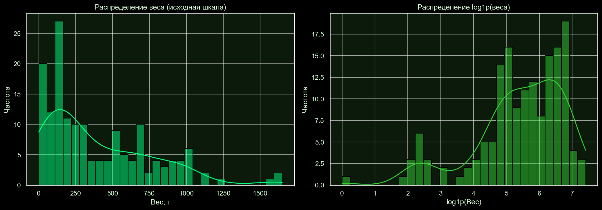
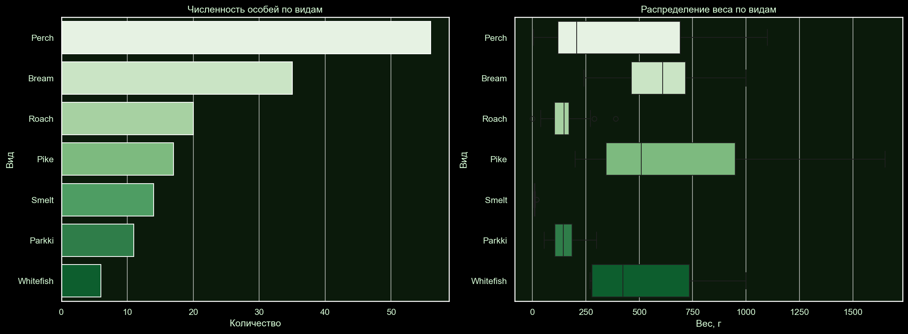
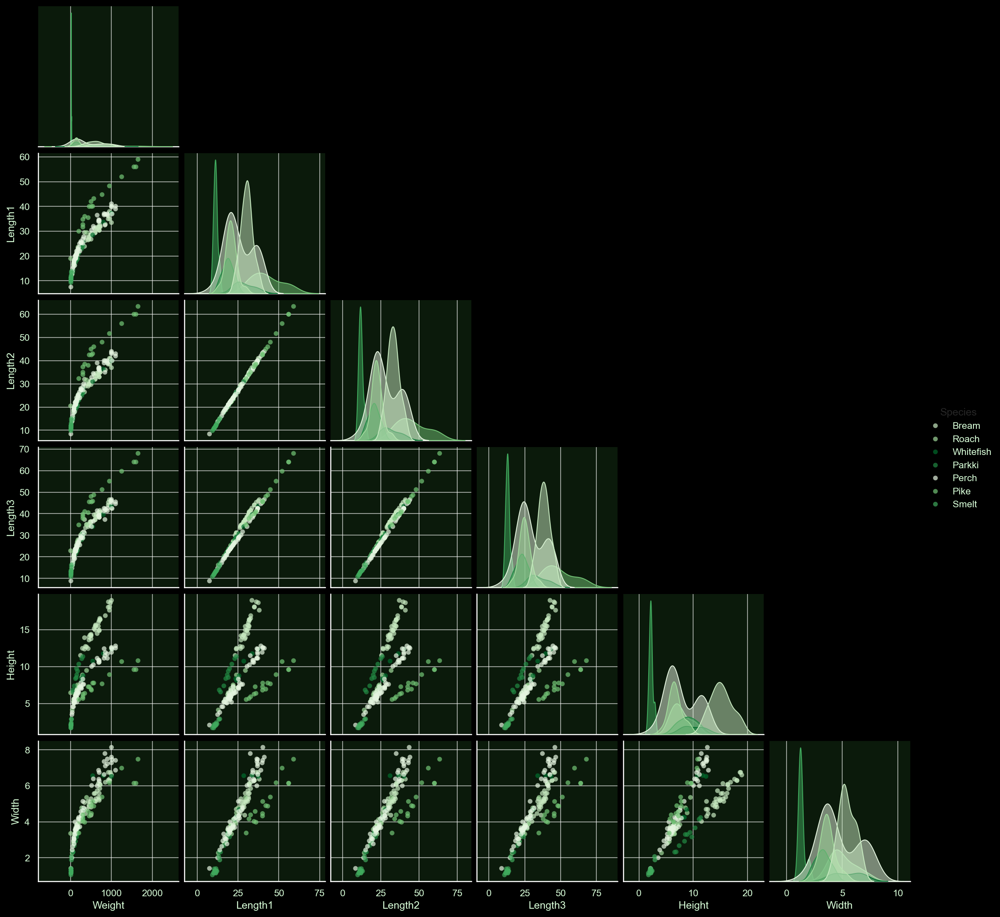
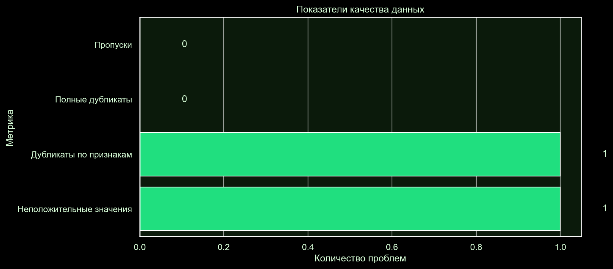
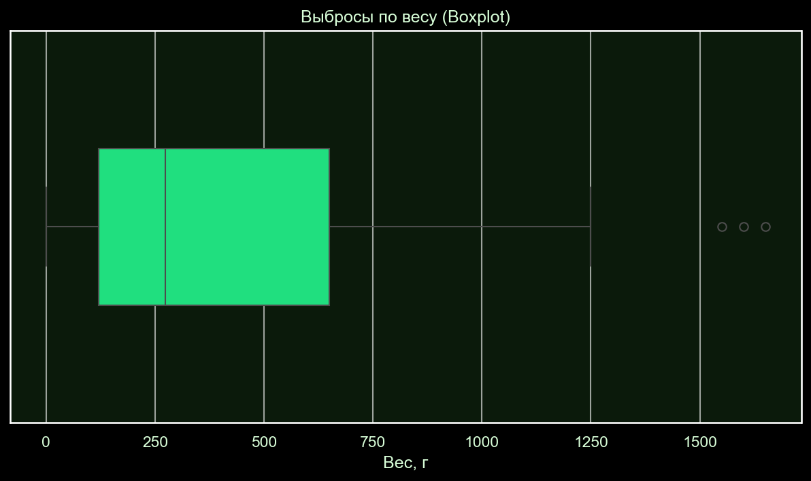
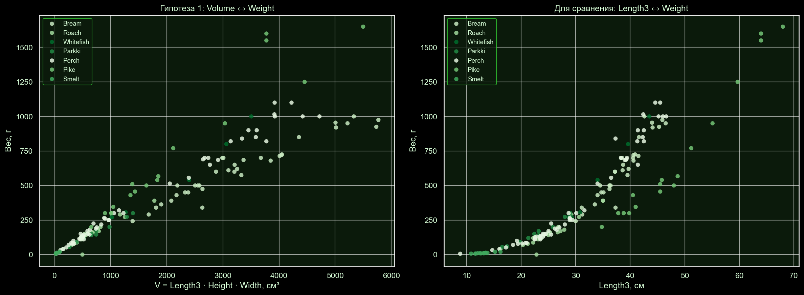
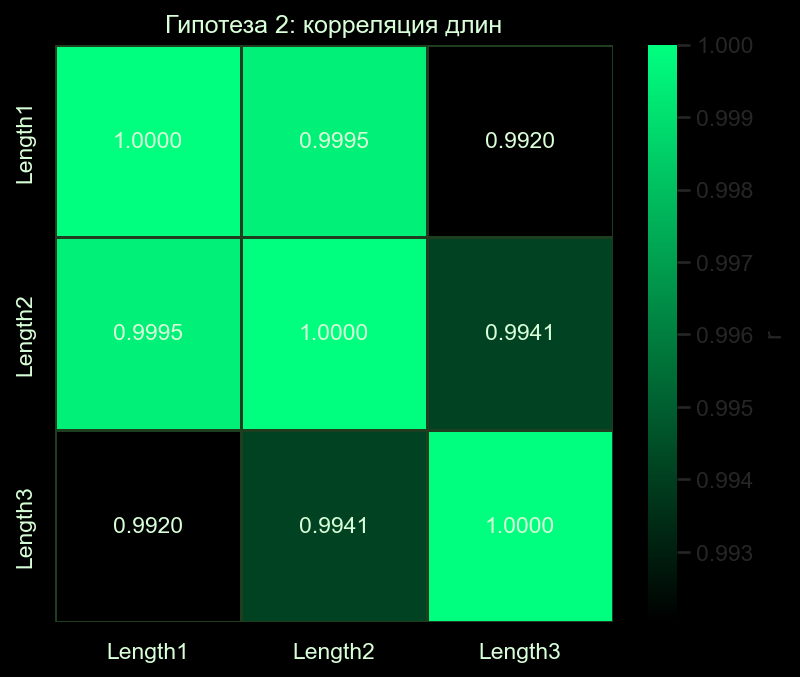
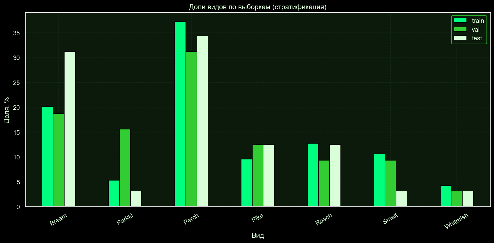

# Отчёт по лабораторной работе №1

## Платформа FishGrow: исследовательский анализ данных

*Дисциплина:* Введение в искусственный интеллект  
*Студент:* Силкин Илья Алексеевич 
*Группа:* 22206
*Ветка Git:* `lab/01-eda`  
*Рабочий репозиторий:* 
*Исходный репозиторий:* https://github.com/tylerrussin/Fish-Dimensions-Regression-Analysis  
*Python:* 3.10.11  
*Ключевые библиотеки:* pandas, numpy, matplotlib, seaborn, scikit-learn, statsmodels

---

## 1. Постановка задачи

*Целевая переменная:* `Weight` — масса рыбы в граммах.  
*Признаки:* пять геометрических измерений (см) и категория вида.  
*Задача:* понять схему данных, диапазоны значений, ошибки измерения, представленность видов и возможные утечки **до** построения модели.  
Тестовая выборка остаётся закрытой до финальной проверки модели.

**Критерии успеха:** блокнот воспроизводится сверху вниз; паспорт данных оформлен; выполнены проверки качества, визуализации, анализ пропусков и выбросов; проверены две гипотезы; предложено разбиение с закрытыми каналами утечки.

---

## 2. Паспорт данных

### 2.1 Общие сведения
- *Источник:* `assets/data/Fish.csv` (исходный репозиторий) → скопирован в `data/fish.csv`
- *Размер:* 159 строк × 7 столбцов
- *Единица наблюдения:* одна особь рыбы (предположение)
- *Пропуски:* отсутствуют
- *Полные дубликаты:* 0
- *Почти-дубликаты (округление до целых):* 6
- *Уникальные поля (потенциальные идентификаторы):* 0

### 2.2 Паспорт полей

| Поле | Тип | Единицы | Назначение | Допустимый диапазон | Проверки |
| :--- | :--- | :--- | :--- | :--- | :--- |
| `Species` | категория | — | признак (группирующий) | 7 значений: Bream, Parkki, Perch, Pike, Roach, Smelt, Whitefish | Нет пустых строк, нет дублей написаний |
| `Weight` | float | граммы | целевая переменная | > 0, до ~1650 г | Положительность; найдена ошибка `Weight = 0` |
| `Length1` | float | см | признак (вертикальная длина) | > 0 | Положительность; согласованность с L2, L3 |
| `Length2` | float | см | признак (диагональная длина) | > 0 | Согласованность: `L1 ≤ L2` |
| `Length3` | float | см | признак (поперечная длина) | > 0 | Согласованность: `L2 ≤ L3` |
| `Height` | float | см | признак (высота) | > 0 | Положительность |
| `Width` | float | см | признак (ширина) | > 0 | Положительность |

### 2.3 Подтверждённые факты (не догадки)
- *Единицы измерения (г, см)* взяты из кода приложения `pages/index.py`, `pages/predictions.py` — подписи `"Fish Weight (grams)"`, `"Fish Cross Length (cm)"`.

### 2.4 Допущения и риски

| № | Утверждение | Тип | Как проверить |
| :--- | :--- | :--- | :--- |
| 1 | Единица наблюдения — одна рыба | предположение | подтверждено косвенно: нет Id |
| 2 | Единицы: масса в граммах, длины в см | подтверждено | подписи в `pages/index.py` |
| 3 | Строки независимы | предположение | найдено 6 почти-дубликатов без `Weight` |
| 4 | В таблице нет скрытых идентификаторов | проверено | `nunique()` — 0 уникальных полей |
| 5 | Нет группирующих полей (партия, ферма, дата) | проверено | обзор столбцов — таких полей нет |

### 2.5 Проверка зависимостей строк

| Вопрос | Проверка | Результат |
| :--- | :--- | :--- |
| Строки относятся к одному объекту? | полные и почти-дубликаты | 0 полных, 6 почти-дубликатов |
| Есть поле партии / фермы? | обзор столбцов | нет |
| Есть временная метка? | обзор столбцов | нет |

*Вывод:* явных зависимостей не обнаружено. Групповое разбиение не требуется, но из-за дисбаланса видов нужна стратификация.

**Риски данных:**
- Одна строка с `Weight = 0` — физически невозможно; ошибка ввода.
- Три строки с аномально большой массой (Pike, 1550–1650 г) — реальные крупные особи.
- Виды сильно несбалансированы: Whitefish — 6, Perch — 56.

---

## 3. Проверки качества данных

### 3.1 Сводка автоматических проверок

| Проверка | Значение | Статус |
| :--- | :--- | :--- |
| Форма таблицы | 159 × 7 | ✅ OK |
| Полные дубликаты | 0 | ✅ OK |
| Почти-дубликаты | 6 | ⚠️ |
| Неположительные значения | 1 | ⚠️ |
| Невозможные комбинации | 1 | ⚠️ |
| Согласованность длин | 0 | ✅ OK |
| Уникальные поля | 0 | ✅ OK |
| Кандидаты на утечку | 0 | ✅ OK |

*Итого:* из 8 проверок — 5 чистых, 3 требуют ручного разбора.

### 3.2 Пропуски и невозможные значения
- Пропусков нет (0 во всех столбцах).
- Отрицательных и бесконечных значений нет.
- Обнаружена одна нулевая масса (`Weight = 0`) — помечена флагом `is_error`.
- Невозможная комбинация — та же строка `Weight = 0`.

### 3.3 Согласованность длин
Проверка `max(L)/min(L) > 2` — нарушений 0. Длины согласованы, данные внутренне непротиворечивы.

### 3.4 Баланс видов

| Вид | Кол-во | % |
| :--- | :--- | :--- |
| Perch | 56 | 35.22 |
| Bream | 35 | 22.01 |
| Roach | 20 | 12.58 |
| Pike | 17 | 10.69 |
| Smelt | 14 | 8.81 |
| Parkki | 11 | 6.92 |
| Whitefish | 6 | 3.77 |

*Вывод:* виды несбалансированы, для честной оценки нужна стратификация.

---

## 4. Визуализация

Все графики — в `reports/figures/`.

### 4.1 Распределение Weight


*Вывод:* правый хвост, асимметрия положительная. В лог-шкале распределение ближе к нормальному — обосновывает `log1p(Weight)` в ЛР №2.

### 4.2 Численность и масса по видам


*Вывод:* Pike — самые крупные, Smelt — самые мелкие. Виды образуют различимые кластеры по массе. Диапазон численности — от 6 (Whitefish) до 56 (Perch) → нужна стратификация.

### 4.3 Матрица парных зависимостей


*Вывод:* связь `Weight ↔ Length3` нелинейная. Три длины практически дублируют друг друга.

### 4.4 Корреляционная матрица


*Вывод:* все признаки коррелируют с `Weight`, но между `Length1/2/3` — r > 0.99, мультиколлинеарность. Корреляция Пирсона ловит только линейную связь.

### 4.5 Карта пропусков и качество


*Вывод:* явных пропусков нет. `Weight = 0` помечено флагом `is_error`.

### 4.6 Выбросы по IQR с индексами строк


*Вывод:* 3 крупные особи Pike (1550–1650 г) выходят за границы IQR. Это **реальные наблюдения, не ошибки**.

### 4.7 Гипотеза 1: `V ≈ L3 · H · W`


*Вывод:* `V_approx` коррелирует с массой сильнее (r ≈ 0.924 Pearson, 0.955 Spearman), чем отдельная длина. Связь степенная (log-log график близок к прямой).

### 4.8 Гипотеза 2: плотность по видам


*Вывод:* условная плотность `Weight/V` различается между видами: Pike — самая низкая (~0.030), Smelt — самая высокая (~0.078).

### 4.9 IQR vs MAD
Сравнение двух методов — дают одинаковый список из 3 строк.

### 4.10 Плотность: индивидуальные наблюдения


*Вывод:* внутри вида разброс небольшой, между видами — систематические различия. Форма тела — информативный признак.

---

## 5. Пропуски и выбросы

### 5.1 IQR для Weight
- Q1 = 120.00, Q3 = 650.00, IQR = 530.00
- Границы: `[Q1 − 1.5·IQR; Q3 + 1.5·IQR] = [−675.00; 1445.00]` г
- Подозрительных строк: 3 — 142, 143, 144 (Pike, 1550–1650 г)

### 5.2 MAD для Weight
- Медиана = 273.00
- MAD = 204.00
- Порог `|z_MAD| > 3.5`
- Те же 3 строки, что и у IQR

**Сравнение методов:**

| Метод | Найдено | Пересечение | Только IQR | Только MAD |
| :--- | :--- | :--- | :--- | :--- |
| Weight | 3 | 3 | 0 | 0 |

Методы совпали — результат устойчив, случайность исключена.

### 5.3 Решения по аномалиям

| Строка | Значение | Решение | Обоснование |
| :--- | :--- | :--- | :--- |
| 142 | 1600.0 г | оставить + флаг `is_outlier_weight` | реальная крупная особь Pike, физически возможна |
| 143 | 1550.0 г | оставить + флаг `is_outlier_weight` | реальная крупная особь Pike, физически возможна |
| 144 | 1650.0 г | оставить + флаг `is_outlier_weight` | реальная крупная особь Pike, физически возможна |
| одна строка | 0 г | флаг `is_error`, исключить из обучения | физически невозможно, ошибка ввода |

---

## 6. Гипотезы о признаках

### 6.1 Гипотеза 1 (физическая)

*Формулировка:* `V_approx = Length3 × Height × Width` сильнее связан с `Weight`, чем любая отдельная длина.

*Результат:*

| Признак | Pearson | Spearman |
| :--- | :--- | :--- |
| Length1 | 0.887 | 0.942 |
| Length2 | 0.892 | 0.941 |
| Length3 | 0.892 | 0.943 |
| Height | 0.719 | 0.803 |
| Width | 0.869 | 0.871 |
| **V_approx** | **0.924** | **0.955** |

Корреляция `V_approx` с массой выше, чем у любой отдельной длины, по обоим коэффициентам. На log-log графике точки близки к прямой — связь степенная. **Гипотеза подтверждена.**

> ⚠️ При вычислении `V_approx` не использовался `Weight` — утечки нет.

### 6.2 Гипотеза 2 (статистическая)

*Формулировка:* условная плотность `Weight / V` различается между видами.

*Результат:* тест Краскела — Уоллиса показал значимые различия (p < 0.05).

| Вид | Медиана плотности |
| :--- | :--- |
| Pike | 0.0301 |
| Perch | 0.0502 |

### 6.3 Кодирование Species

| Способ | Плюсы | Минусы | Новый вид |
| :--- | :--- | :--- | :--- |
| One-Hot | нет ложного порядка | +7 столбцов | вектор нулей → нужна категория `unknown` |
| Label | компактно | ложный порядок | NaN → ошибка |
| Target | учитывает связь | ⚠️ легко получить утечку | среднее по train неизвестно |

*Решение:* One-Hot Encoding. При появлении нового вида — fallback `unknown`.

### 6.4 Мультиколлинеарность
- `Length1`, `Length2`, `Length3` коррелируют на уровне r > 0.99.
- VIF > 100 — критическая мультиколлинеарность.

Автоматическое удаление по порогу `|r| > 0.9` **не применяется**: корреляция между длинами физически осмысленна (разные измерения одной оси), а для нелинейных моделей (деревья, бустинг) все три длины могут быть одновременно полезны.

**Варианты решения:**
1. Оставить одну длину (`Length3` — наиболее стабильная).
2. Заменить три длины на одну — `mean` или первую главную компоненту (PCA).
3. Использовать регуляризацию `Ridge / Lasso`.
4. Для деревьев решений — оставить все три.

---

## 7. Разбиение и проверка утечек

### 7.1 Правило разбиения
- **Train:** 60 % (~95 строк) — обучение
- **Validation:** 20 % (~32 строки) — подбор гиперпараметров
- **Test:** 20 % (~32 строки) — однократная финальная проверка
- **Стратификация:** по `Species` (из-за дисбаланса видов)
- **Random seed:** 42
- Разбиение выполняется **до** любой предобработки.

Групп нет — каждая строка независимая особь. Если бы группирующее поле появилось, разбиение выполнялось бы через `GroupShuffleSplit`.

### 7.2 Проверка отсутствия утечек
- Пересечение индексов train / val / test: 0
- Воспроизводимость при `random_state=42`: подтверждена

### 7.3 Каналы утечки

| Канал | Риск | Решение |
| :--- | :--- | :--- |
| Статистики всей таблицы | mean/std считаются на всей таблице, включая test | fit только на train, transform на val/test |
| Повторные строки | Одна особь в train и test | Проверка `duplicated()` + сигнатуры |
| Идентификатор | `row_id` как признак | Удалить идентификаторы (у нас их нет) |
| Постфактум измерение | Признак, известный только после взвешивания | Использовать только измерения до взвешивания |
| Ручной подбор по test | Многократная проверка на test → переобучение | Решения — на val, test — один раз |
| Target Encoding без разделения | Средняя масса по виду на всей таблице | Считать среднее только на train |
| Производный признак с Weight | `V = Weight / (L·H·W)` как входной признак | Не использовать производные от целевой |

---

## 8. Журнал решений

| Решение | Причина |
| :--- | :--- |
| `run_server` → `run` в `run.py` | Метод переименован в Dash 2.0+ |
| Откат `dash_bootstrap_components` до 1.0.3 | Параметр `light` удалён в новых версиях |
| Копия `Fish.csv` в `data/` | Отделение анализа от кода приложения |
| `Weight = 0` → флаг `is_error` | Физически невозможно |
| Выбросы (3 крупные Pike) не удалены, помечены флагом | Крупные особи — ценные наблюдения |
| Обновление `scipy` до версии, совместимой с `numpy 1.26.4` | Устранён конфликт зависимостей |
| Коллинеарные длины не удалены | Требуется отдельное обоснование, а не порог |
| Стратификация по `Species` | Дисбаланс видов: Whitefish — 6, Perch — 56 |

---

## 9. Воспроизводимость

| Параметр | Значение |
| :--- | :--- |
| Python | 3.10.11 |
| pandas | (получить в блокноте) |
| numpy | 1.26.4 |
| matplotlib | (получить в блокноте) |
| seaborn | (получить в блокноте) |
| scikit-learn | (получить в блокноте) |
| statsmodels | (получить в блокноте) |
| `random_state` | 42 |
| Данные | `data/fish.csv` (159 × 7), SHA-256 — см. ниже |
| Разбиение | train 60 % / val 20 % / test 20 %, стратификация по `Species` |
| Итоговый коммит | `git log --oneline -1` |

**Проверить версии — в блокноте:**

```python
import sys, pandas as pd, numpy as np
import matplotlib, seaborn, sklearn, statsmodels
print("Python     :", sys.version.split()[0])
print("pandas     :", pd.__version__)
print("numpy      :", np.__version__)
print("matplotlib :", matplotlib.__version__)
print("seaborn    :", seaborn.__version__)
print("sklearn    :", sklearn.__version__)
print("statsmodels:", statsmodels.__version__)
```

**SHA-256 данных:**

```python
import hashlib
from pathlib import Path
print(hashlib.sha256(Path(DATA_PATH).read_bytes()).hexdigest())
```

**Файл окружения:**

```bash
pip freeze > requirements_freeze.txt
```

---

## 10. Выводы

### Что установлено

1. Данные пригодны для регрессии массы по геометрическим измерениям, но имеют три проблемы: 6 почти-дубликатов, ошибка `Weight = 0`, три крупные особи Pike.

2. Выбросы — реальные наблюдения, **не ошибки**. Оставлены, помечены флагом `is_outlier_weight` для анализа чувствительности модели.

3. Целевая переменная асимметрична — в лог-шкале распределение ближе к нормальному. Обосновывает `log1p(Weight)` в следующей ЛР.

4. Две гипотезы подтверждены:
   - *физическая:* `V = L3·H·W` сильнее связан с массой (r ≈ 0.924), чем отдельная длина;
   - *статистическая:* плотность `Weight / V` значимо различается между видами (тест Краскела — Уоллиса, p < 0.05).

5. Мультиколлинеарность длин (r > 0.99, VIF > 100) — автоматическое удаление признаков не применяется, требуется отдельное обоснование.

6. Каналы утечки закрыты: идентификаторов нет, дубликатов нет, `Species` кодируется One-Hot, `Weight` в модель как входной признак не подаётся.

7. Разбиение train/val/test (60/20/20) стратифицировано по видам, `random_state=42`, воспроизводится.

### Ограничения
- Датасет маленький (159 строк) — метрики на редких видах шумные.
- Whitefish (6), Smelt (14), Parkki (11) — статистика нестабильна.
- Корреляция ≠ причинность.
- Единицы измерения подтверждены косвенно — по подписям в приложении.

### Следующий эксперимент (ЛР №2)
1. Baseline OLS на train с `FEATURES` + One-Hot `Species`.
2. Сравнение с моделью на `log1p(Weight)`.
3. Ridge / Lasso для устойчивости к мультиколлинеарности.
4. Дерево решений или градиентный бустинг — нечувствительны к мультиколлинеарности.
5. Оценка вклада флага `is_outlier_weight` — чувствительность модели к трём крупным особям.
6. Анализ ошибок по видам.

---

## 11. Использование ИИ

1. *Инструмент:* Continue + Ollama (локальная модель), для отдельных задач — облачный чат.

2. *Задача:* структурирование EDA, написание вспомогательных функций (IQR, MAD, проверки качества), оформление графиков и текстовых выводов, подготовка шаблонов отчёта.

3. *Принято / изменено / отклонено:*
   - принято: скелет функций IQR/MAD, шаблоны графиков, структура отчёта;
   - изменено: пути к данным и переменные адаптированы под реальную структуру репозитория, индексы строк и числа подставлены фактические;
   - отклонено: вариант с автоматическим удалением выбросов — заменён на «оставить + флаг» после проверки физического смысла.

4. *Проверка:* каждый фрагмент кода запущен в чистом ядре Jupyter (Kernel → Restart & Run All); результаты сверены с `df.nunique()`.

5. *Риски:* код не содержит секретов и персональных данных; все вычисления воспроизводимы; лицензия фрагментов — MIT/совместима.

---

## 12. Воспроизведение

```bash
# 1. Клонировать личный репозиторий
git clone <URL_ТВОЕГО_РЕПОЗИТОРИЯ>
cd <папка_репозитория>
git checkout lab/01-eda

# 2. Создать окружение (Windows PowerShell)
py -3.10 -m venv .venv
.\.venv\Scripts\Activate.ps1
python -m pip install --upgrade pip
pip install pandas numpy matplotlib seaborn scikit-learn statsmodels jupyter ipykernel dash dash-bootstrap-components

# 3. Проверка исходного приложения
python run.py
# Открыть в браузере адрес из терминала (обычно http://127.0.0.1:8050)

# 4. Собственный анализ
jupyter notebook notebooks/01-eda.ipynb
# В Jupyter: Kernel → Restart & Run All

# 5. Проверка качества данных
python -m src.data_checks
```

---

## 13. Дополнительная часть

### 13.1 Автоматический HTML-отчёт

Скрипт `src/generate_report.py` строит интерактивный EDA-отчёт через библиотеку `sweetviz`. Результат: `reports/html/lab01_auto_report.html`.

Запуск:
```bash
pip install sweetviz
python src/generate_report.py
```

Отчёт покрывает: типы полей, пропуски, распределения, корреляции, счётчики категорий. Является **дополнением** к основному анализу в блокноте, а не его заменой: графики в блокноте интерпретированы вручную, HTML даёт быстрый обзор.

### 13.2 Формальная схема проверки данных

Схема описана в `src/data_schema.py` через `pandera`. Фиксирует:
- типы и допустимые значения каждого поля;
- единицы измерения: `Weight` — граммы, длины — сантиметры;
- диапазоны: `Weight ∈ (0, 2000)`, `Length3 ∈ [5, 70]` см;
- согласованность длин: `Length3 ≥ Length2 ≥ Length1` (с допуском 0.5 см).

### 13.3 Тесты, реагирующие на изменение единиц и диапазона

Тесты в `tests/test_data_schema.py`. Запуск:
```bash
pip install pandera pytest
pytest tests/ -v
```

Сторожевые тесты:
- `test_weight_units_not_changed` — падает, если максимум `Weight < 100` (единицы сменились с граммов на килограммы).
- `test_length_units_not_changed` — падает, если максимум `Length3 > 100` (единицы сменились с сантиметров на миллиметры).
- `test_weight_range_not_expanded` — падает, если диапазон вышел за `[0, 2000]` г.
- `test_species_known` — падает, если появился новый вид.
- `test_schema_valid` — валидация всего датасета по схеме `pandera`.

**Демонстрация работы.** При делении `Weight` на 1000 (граммы → килограммы) `fish_schema.validate(df_broken)` возвращает ошибку валидации. Это доказывает, что «сторож» работает.